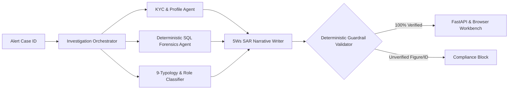

# 🛡️ Agentic SAR Investigation & Narrative Co-Pilot


A multi-agent Financial Crime investigation platform built with **FastAPI** and **Python** that automates evidence gathering, typology classification, and audit-ready **5Ws (Who, What, When, Where, Why) FinCEN SAR narrative synthesis**—protected by a deterministic **compliance guardrail** that blocks unverified figures or hallucinated transaction citations.

📐 **Deep-Dive System Architecture:** Read the full [High-Level Design (HLD)](docs/HLD.md) and [Low-Level Design (LLD)](docs/LLD.md).

---

## Architecture Overview



---

## Covered Financial Crime Typologies & Subject Framing

Unlike generic alert scorers, the engine classifies both the **regulatory typology** and the **Subject Role** (`COMPLICIT_ACTOR` vs. `VICTIM` vs. `NEUTRAL_BENIGN`):

| Typology Code | Category | Subject Framing | Key Detection Logic |
| :--- | :--- | :--- | :--- |
| `CSAM_ZERO_TOLERANCE_ESCALATION` | CSAM / Severe Harm | `COMPLICIT_ACTOR` | Immediate mandatory priority escalation; zero auto-closure allowed |
| `ELDER_FINANCIAL_EXPLOITATION` | Elder Financial Exploitation | `VICTIM` | Subject **Age ≥ 60** + urgent/imposter outbound transfers to new payees |
| `ACCOUNT_TAKEOVER_ATO` | Account Takeover (ATO) | `VICTIM` | Unrecognized device/IP + credential reset event followed by rapid drain |
| `SCAM_AUTHORIZED_PUSH` | Scam (APP / Investment) | `VICTIM` | Escalating push payments to high-risk investment counterparties |
| `MONEY_MULE_PASS_THROUGH` | Money Mule | `COMPLICIT_ACTOR` | High-velocity P2P fan-in (`≥ 4` senders) + `≥ 80%` outbound funneling `< 60m` |
| `ML_LAYERING` | Money Laundering (Layering) | `COMPLICIT_ACTOR` | Multi-channel rapid movement (`P2P -> WIRE/ACH`) with minimal holding time |
| `ML_SUSPICIOUS_SOF` | Money Laundering (SOF) | `COMPLICIT_ACTOR` | 30-day inbound volume `≥ 3.0x` declared KYC monthly income |
| `PAYMENT_ACQUIRING_FRAUD` | Fraud (Card / Acquiring) | `COMPLICIT_ACTOR` | Card-testing / chargeback spikes followed by immediate merchant settlement |

---

## Quickstart & Local Execution

```bash
git clone https://github.com
cd agentic-sar-copilot
pip install -r requirements.txt
```

### 1. Run Automated Pytest Suite (10 Tests)
```bash
python -m pytest -v
```

### 2. Launch Interactive Investigator Workbench
```bash
python -m uvicorn src.api:app --reload
```
Open **`http://127.0.0`** in your browser to inspect all 8 pre-seeded synthetic FinCrime cases and review live guardrail-verified SAR drafts.
