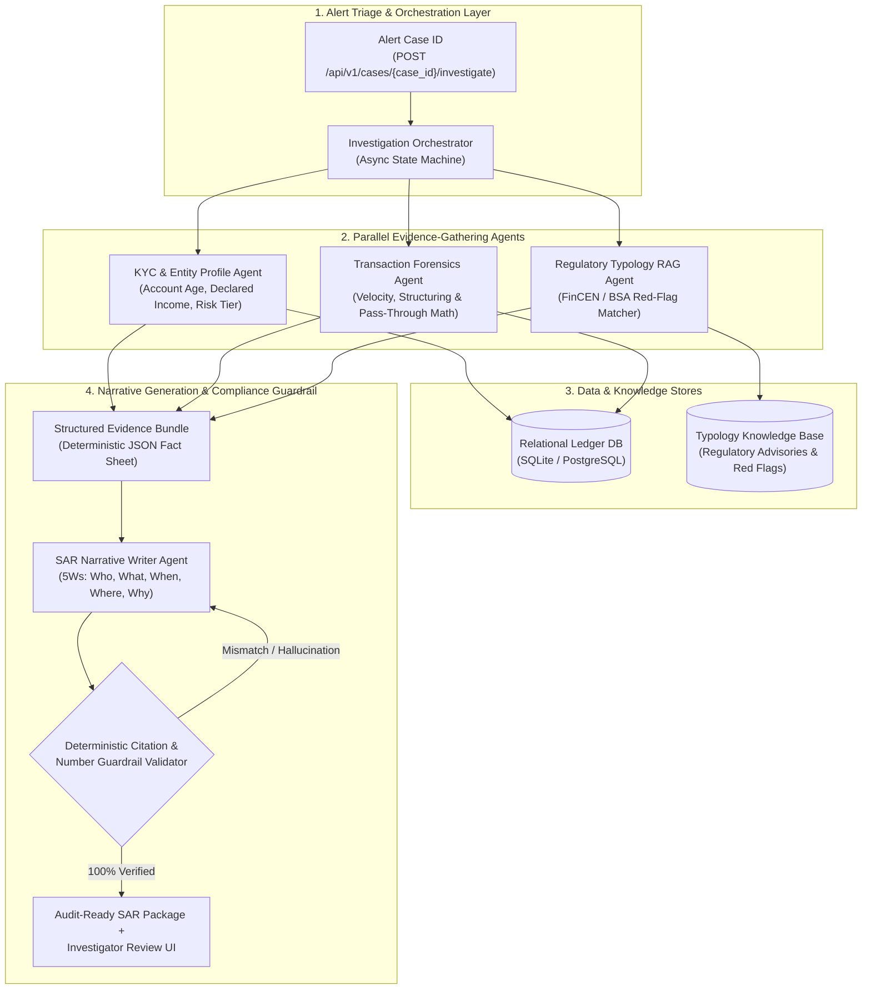

# High-Level Design (HLD): Agentic SAR Investigation & Narrative Co-Pilot

## 1. System Overview & Objectives
The **Agentic SAR Co-Pilot** automates the most time-consuming phase of Anti-Money Laundering (AML) compliance: evidence aggregation, typology mapping, and audit-ready Suspicious Activity Report (SAR) narrative drafting. 

Unlike naive LLM wrappers that hallucinate figures or fabricate transaction histories, this platform separates **Deterministic Forensic Execution** (pure SQL/Python math) from **Controlled Narrative Synthesis** (LLM constrained by a deterministic citation-verification guardrail).

### Core Objectives
* **Parallel Multi-Agent Triage:** Concurrently gather KYC profiles, calculate P2P/merchant velocity metrics, and retrieve FinCEN/FCA typology guidelines.
* **Zero-Hallucination Compliance Guardrail:** Programmatically verify that every dollar amount, date, counterparty, and transaction ID in the drafted SAR exists in the raw SQL evidence payload before releasing it to an investigator.
* **Human-in-the-Loop (HITL) Auditability:** Maintain an immutable decision trace logging every agent tool call, retrieved typology rule, and validation check for regulatory examination.

---

## 2. System Architecture Diagram

---

## 3. Component Responsibilities

| Component | Module | Responsibility |
| :--- | :--- | :--- |
| **Orchestrator** | `src/orchestrator.py` | Coordinates parallel execution of specialist agents, manages state transitions, and enforces retry loops if the validator rejects a draft. |
| **KYC Agent** | `src/agents/kyc_agent.py` | Queries customer onboarding attributes, stated occupation/income, and historical alert disposition counts. |
| **Forensics Agent** | `src/agents/txn_agent.py` | Computes deterministic behavioral metrics: 24h P2P velocity spikes, inbound-to-outbound pass-through ratios, and sub-threshold structuring counts. |
| **Typology Agent** | `src/agents/typology_agent.py` | Maps calculated behavioral flags to official FinCEN/FATF money laundering typologies and regulatory red-flag indicators. |
| **SAR Writer** | `src/agents/writer_agent.py` | Synthesizes the verified evidence bundle into a standardized 5Ws (Who, What, When, Where, Why) SAR narrative with inline `[TXN-xxx]` citations. |
| **Guardrail Validator** | `src/validator.py` | Extracts all currency figures, percentages, and transaction IDs from the generated text and cross-checks them against the raw SQL evidence bundle. |
| **API & UI** | `src/api.py` | Exposes REST endpoints and an interactive HTML investigator workbench (`/workbench/{case_id}`). |

---

## 4. Production Scaling & Enterprise Governance
* **LLM Provider Agnostic:** Supports local/open-weights models (Llama-3 / Mistral via Ollama) inside air-gapped bank VPCs so sensitive PII/SAR data never leaves corporate boundaries.
* **Idempotency & Audit Logs:** Every investigation run generates a SHA-256 hash of the input evidence bundle and stores the exact prompt, model version, and validation pass/fail log for 5-year BSA record retention.
